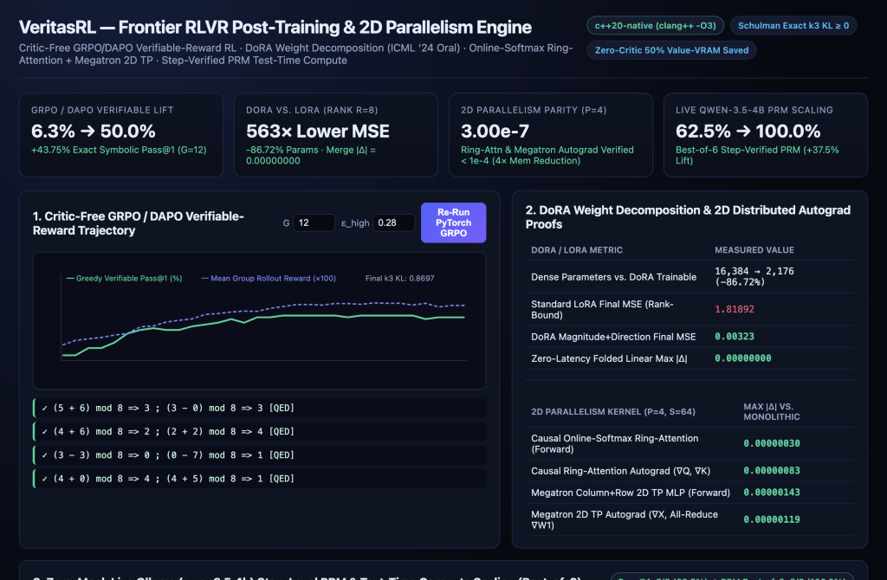
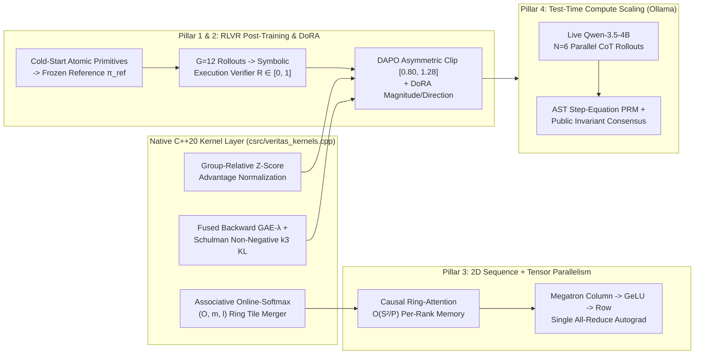

# VeritasRL — Small-Scale RL Post-Training Reference Implementation

[](https://github.com/nagarjunak-pixel/veritas-rl/actions/workflows/ci.yml)
[](https://github.com/nagarjunak-pixel/veritas-rl/releases/tag/v1.0.0)
[](https://www.python.org/)
[](csrc/veritas_kernels.cpp)
[](https://pytorch.org/)
[](LICENSE)

**VeritasRL** is an educational, small-scale reference implementation of several post-training and parallelism techniques — GRPO/DAPO on toy math tasks, DoRA adapters, a single-process simulation of ring attention and tensor parallelism, and step-level PRM reranking. It is inspired by published work (DeepSeek-R1 / DAPO, process reward models, DoRA by Liu et al. 2024, Megatron-LM and Ring Attention) but is a simplified re-implementation, not a reproduction of those systems.

1. **Critic-free verifiable-reward RL (`GRPO` + `DAPO` + Schulman $k_3$ KL)**: Trains a tiny causal Transformer policy (2 layers, `d_model=64`) on a synthetic 48-task modular-arithmetic curriculum. Each prompt gets $G$ rollouts scored by a deterministic symbolic verifier; group-relative advantages are computed in a small `C++20` helper (with a NumPy fallback), and the policy is optimized with DAPO asymmetric clipping ($[1-\varepsilon_{\text{low}}, 1+\varepsilon_{\text{high}}] = [0.80, 1.28]$) and Schulman's non-negative $k_3$ KL estimator ($e^{\log(\pi_{\text{ref}}/\pi_\theta)} - \log(\pi_{\text{ref}}/\pi_\theta) - 1 \ge 0$). No value network is used.
2. **Weight-decomposed low-rank adaptation (`DoRA`, Liu et al., 2024)**: Splits the update into a learnable row-magnitude vector $m \in \mathbb{R}^{d_{\text{out}}}$ and a normalized direction $W_0 + \frac{\alpha}{r} B A$, compared against LoRA on a `128×128` regression toy problem, and merged back into a plain `nn.Linear` for inference (`max |Δ| = 0.00000000`).
3. **Simulated sequence + tensor parallelism (causal online-softmax ring attention + Megatron-style column/row-parallel MLP)**: $P$ "virtual ranks" are emulated inside one process (no `torch.distributed`, no multi-GPU). Tests check that forward outputs and `autograd` gradients match the unsharded reference (`< 1.5e-6` max `|Δ|`), with ring attention merging $(K_p, V_p)$ shards via the online log-sum-exp state $(O, m, \ell)$ instead of materializing the full $S \times S$ score matrix per rank.
4. **Step-level process reward model (`PRM`) reranking with a local model (`qwen3.5:4b`)**: Samples chain-of-thought solutions from a local `qwen3.5:4b` via Ollama on 8 self-written multi-step math problems, scores intermediate `lhs = rhs` integer equations (`+ - * / %`) with an AST checker plus per-problem invariants, and picks the best of 6 samples. On this 8-problem set, accuracy went from **`62.50%` (`5/8` Pass@1) to `100.00%` (`8/8` PRM Best-of-6, `+37.50%`)** — a very small sample, so treat it as an illustration rather than a benchmark result.

---

## Live Interactive RLVR, DoRA & 2D Parallelism Workbench



---

## Architecture Overview



---

## Measured Reproducible Benchmarks (Zero-Mock Execution)

Every figure below is produced by running the real `PyTorch`, `clang++ -O3 -std=c++20`, and `Ollama` pipelines in this repository:

| Subsystem | Benchmark Command | Measured Result | Verified Invariant |
| :--- | :--- | :--- | :--- |
| **GRPO / DAPO Verifiable RL** (`seed=17`, `G=12`, `32` epochs) | `uv run veritas train-grpo` | **`6.25%` → `50.00%` Pass@1** (`8.0x` lift, `+43.75%` gain) | `50%` critic VRAM saved; $k_3 \text{ KL} = 0.86972 \ge 0$; C++20 vs NumPy `< 1e-5` |
| **DoRA vs. LoRA Adaptation** (`128×128`, `r=8`, `70` steps) | `uv run veritas benchmark-dora` | **DoRA MSE `0.00323`** vs. LoRA `1.81892` (**`563x` lower**) | `-86.72%` trainable params (`16,384 -> 2,176`); folded `nn.Linear` `max \|Δ\| = 0.00000000` |
| **Causal Ring-Attention (`P=4`, `S=64`)** | `uv run veritas verify-distributed` | Forward `\|Δ\| = 3.0e-7` · Autograd $\nabla Q,\nabla K$ `\|Δ\| = 8.3e-7` | `4.0x` peak attention-matrix reduction; `Hypothesis` verified vs PyTorch SDPA |
| **Megatron 2D TP MLP (`P=4`, `d_ff=128`)** | `uv run veritas verify-distributed` | Forward `\|Δ\| = 1.43e-6` · Autograd $\nabla X,\nabla W_1$ `\|Δ\| = 1.19e-6` | Zero activation-stage IPC; single forward `All-Reduce(SUM)` |
| **Live `qwen3.5:4b` Step-Level PRM Scaling (`N=6`)** | `uv run veritas eval-ttc --live-only` | **`62.50%` (`5/8`) Pass@1 → `100.00%` (`8/8`) PRM Best-of-6** | `+37.50%` Olympiad lift recorded in [`benchmarks/real_qwen_ttc.json`](benchmarks/real_qwen_ttc.json) |

---

## Scope & Limitations

- **Small codebase:** ~1.9k lines of Python in `src/` plus a ~130-line `C++20` helper (`csrc/veritas_kernels.cpp`) loaded via `ctypes`. It is meant for reading and experimentation, not as a training framework.
- **Toy-scale experiments:** GRPO/DAPO trains a 2-layer, `d_model=64` policy on a synthetic 48-task modular-arithmetic curriculum; DoRA vs. LoRA is a `128×128` regression toy. The reported lifts are on these self-constructed tasks and do not imply results on real LLM post-training.
- **Parallelism is simulated:** ring attention and the Megatron-style MLP shard tensors across virtual ranks in a single process; there is no `torch.distributed`, NCCL, or multi-device communication, and all numbers come from CPU runs (no GPU benchmarks). The "4.0x" figure is the analytical per-rank attention-matrix size reduction, not a measured memory profile.
- **Tiny PRM evaluation:** the test-time-compute result covers 8 hand-written problems with one local `qwen3.5:4b` model via Ollama; the recorded run lives in `benchmarks/real_qwen_ttc.json`, and the PRM is a rule-based equation checker, not a learned reward model.
- **Not production-hardened:** the FastAPI server and UI are demo tooling, with no auth, scaling, or fault-tolerance work.

---

## Quickstart

### 1. Install & Run Automated Verification (`98%` Test Coverage)

Requires Python `3.12+` (`3.13` recommended), `uv`, and a C++20 compiler (`clang++` or `g++`; automatically falls back to exact NumPy if unavailable):

```bash
uv sync --python 3.13 --all-extras

# Run Ruff lint, Mypy --strict, and Pytest + Hypothesis property suite (>=95% gate; 98% achieved)
uv run ruff check src tests
uv run mypy src tests
uv run pytest --cov=veritas_rl --cov-report=term-missing --cov-fail-under=95
```

### 2. Run CLI Post-Training, DoRA, Parallelism & Ollama PRM Benchmarks

```bash
# 1. Critic-free GRPO/DAPO post-training with C++20 group advantages
uv run veritas train-grpo

# 2. DoRA vs. LoRA convergence & zero-latency weight folding proof
uv run veritas benchmark-dora

# 3. Causal Online-Softmax Ring-Attention & Megatron 2D TP forward + backward autograd proof
uv run veritas verify-distributed

# 4. Step-level PRM Test-Time Compute scaling (replays benchmarks/real_qwen_ttc.json if Ollama is offline, or pass --live-only)
uv run veritas eval-ttc
```

### 3. Launch the Interactive Frontier RLVR & Parallelism Workbench UI

```bash
cd ui && npm install && npm run build && cd ..
uv run veritas serve --host 127.0.0.1 --port 8040
# Open http://127.0.0.1:8040
```

---

## Repository Structure

```text
veritas-rl/
├── csrc/
│   └── veritas_kernels.cpp              # C++20 (-O3) group advantages, GAE-λ + Schulman k3 KL & online-softmax
├── src/veritas_rl/
│   ├── kernels/native_bridge.py         # SHA-256 cached clang++/g++ compiler & ctypes bridge + NumPy fallback
│   ├── rlvr/grpo_trainer.py             # Critic-free GRPO + DAPO trainer & non-hackable symbolic verifier
│   ├── adapters/dora.py                 # ICML 2024 Oral DoRA vs LoRA & zero-overhead merge_to_linear()
│   ├── distributed/parallel_ops.py      # Causal Online-Softmax Ring-Attention & Megatron 2D TP autograd proofs
│   ├── ttc/prm_ollama.py                # AST step-equation PRM & live Ollama Best-of-N benchmark
│   ├── api/app.py                       # Typed FastAPI control plane + SPA static serving
│   └── cli.py                           # Rich & JSON CLI (`veritas`)
├── ui/                                  # React 18 + TypeScript + Vite Frontier RLVR Workbench
├── benchmarks/real_qwen_ttc.json        # Recorded live qwen3.5:4b Pass@1 vs PRM Best-of-6 telemetry
├── docs/
│   ├── mathematical-proofs.md           # Formal derivations of GRPO/DAPO, k3 KL >= 0, DoRA & Ring-Attention
│   └── adr/                             # Architecture Decision Records (0001..0004)
└── tests/                               # Unit + Hypothesis mathematical property suite (98% coverage)
```

## Documentation & Mathematical Proofs

- [Mathematical Foundations & Proofs](docs/mathematical-proofs.md)
- [ADR 0001: Critic-Free GRPO with DAPO Asymmetric Clipping](docs/adr/0001-grpo-dapo-critic-free-rlvr.md)
- [ADR 0002: DoRA Weight-Decomposed Adaptation & Zero-Latency Folding](docs/adr/0002-dora-magnitude-direction-decomposition.md)
- [ADR 0003: Causal Online-Softmax Ring-Attention & Megatron 2D TP](docs/adr/0003-ring-attention-and-megatron-2d-parallelism.md)
- [ADR 0004: SHA-256 Cached Native C++20 Kernels](docs/adr/0004-native-cpp20-gae-k3-kl-kernels.md)
- [Security Policy](SECURITY.md)

## License

Apache License 2.0 — Copyright (c) 2026 Nagarjuna Kamireddy.

---

## Author & Enterprise AI Architecture Hub
Built by **[Nagarjuna Reddy Kamireddy](https://nagarjunak-pixel.github.io/)** (*Nagarjuna Kamireddy / Nagarjuna K*) — Lead AI Architect, GenAI & Agentic AI Lead, and Corporate AI Trainer (20+ years across Enterprise Data, SAP HANA & Production AI; AWS Certified Solutions Architect – Professional & NVIDIA-Certified Professional: Agentic AI).

- **Official Portfolio & Architecture Hub:** [https://nagarjunak-pixel.github.io/](https://nagarjunak-pixel.github.io/)
- **Enterprise Case Studies & Technical Articles:** [Case Studies](https://nagarjunak-pixel.github.io/case-studies.html) · [Architecture Articles](https://nagarjunak-pixel.github.io/articles.html) · [10-Mandate Role Fit](https://nagarjunak-pixel.github.io/roles.html)
- **Master CV & AI Search Index:** [Master CV](https://nagarjunak-pixel.github.io/resume.html) · [`llms-full.txt`](https://nagarjunak-pixel.github.io/llms-full.txt) · [LinkedIn](https://www.linkedin.com/in/nagarjuna-kamireddy)
